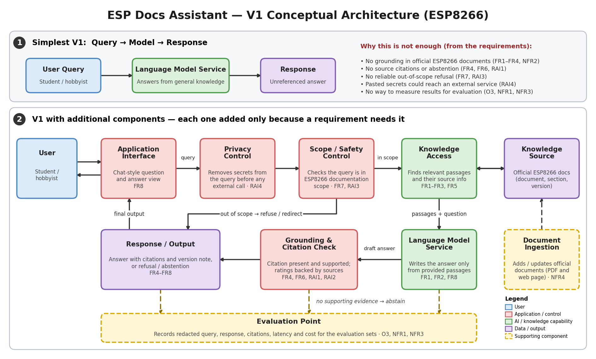

# Architecture Decisions & Traceability — ESP Docs Assistant (ESP8266)

**Course:** AI Engineering — Topic 2 Lab
**Author:** Osama
**Version:** 1.0
**Date:** 22 October 2026

This document records the key architecture decisions for the V1 conceptual architecture (`week2_architecture_v1.png`), the trade-offs accepted, and the initial requirements traceability matrix. It builds on `week2_requirements.md` and `week2_evaluation_criteria.md`.

V1 is a conceptual architecture. Components are labelled by function; specific models, retrieval approaches, frameworks, and platforms are deliberately not chosen yet and will be selected in later topics.

---

## Architecture Needs from the Requirements

Starting point: **User Query → Language Model Service → Response**. This simple flow cannot meet the requirements below, so each added component is justified by a specific need.

| Requirement ID | What the requirement needs | Architecture Response |
|---|---|---|
| FR1, FR2, FR3, FR5, NFR2 | Answers must come from the official ESP8266 documents, including questions that span documents and information about which document/version applies. | Knowledge Source and Knowledge Access |
| FR4, FR6, RAI1, RAI2 | Every answer needs a verifiable reference; unsupported answers and unsupported electrical numbers must be prevented; missing evidence must lead to abstention. | Source information kept with each passage, plus a Grounding & Citation Check |
| FR7, RAI3 | Out-of-scope queries must be refused and redirected. | Scope / Safety Control |
| RAI4 | Pasted secrets (Wi-Fi passwords, API keys, tokens) must not reach external model services. | Privacy Control |
| NFR4 | New or updated documents must be added without rebuilding unrelated components. | Document Ingestion, separate from the query path |
| NFR1, NFR3, O3 | Latency, cost, and answer quality must be measurable on defined workloads. | Evaluation Point |
| FR8 | Answers must be written in clear language for beginners. | Language Model Service, presented through the Application Interface |

---

## Architecture Components

| Component | Function | Requirements supported |
|---|---|---|
| Application Interface | Chat-style question-and-answer view between the user and the system. | FR8 |
| Privacy Control | Removes secrets from the query before anything is sent to an external service. | RAI4 |
| Scope / Safety Control | Checks that the query falls within ESP8266 documentation scope; routes out-of-scope queries to a refusal and redirect. | FR7, RAI3 |
| Knowledge Access | Finds the relevant passages, with their source information, for an in-scope query. | FR1, FR2, FR3, FR5, NFR2 |
| Knowledge Source | Holds the official ESP8266 documents with document, section, and version information. | FR1–FR5, RAI1 |
| Language Model Service | Writes the answer from the provided passages. | FR1, FR2, FR8 |
| Grounding & Citation Check | Checks that citations are present and supported, that electrical ratings are backed by the sources, and abstains when evidence is missing. | FR4, FR6, RAI1, RAI2 |
| Response / Output | Returns the answer with citations and a version note, or a refusal / abstention. | FR4–FR8 |
| Document Ingestion | Adds or updates official documents (PDF and web page) in the Knowledge Source. | NFR4 |
| Evaluation Point | Records the redacted query, response, citations, latency, and cost for the evaluation sets. | O3, NFR1, NFR3 |

---

## Architecture Decision Record (ADR)

| ID | Decision | Requirement / Constraint | Alternatives Considered | Selected Option | Trade-off Accepted |
|---|---|---|---|---|---|
| ADR1 | Include knowledge access | FR1–FR5, NFR2, RAI1 — answers must be grounded in and cited from the official ESP8266 documents (O1, O2). | (a) Base model only; (b) load the full documents into every request; (c) static keyword search over the documents; (d) dynamic knowledge access that selects relevant passages per query. | Dynamic knowledge access: a Knowledge Access component that selects relevant passages, with their source information, from a Knowledge Source. | More system complexity and added retrieval time, and answer quality now depends on retrieval quality, in exchange for better grounding and traceability. |
| ADR2 | Include an explicit scope control before answering | FR7, RAI3 — out-of-scope queries must be refused (≥ 95% refusal-and-redirect). | (a) Rely on an instruction to the model only; (b) explicit scope-control component; (c) filter only after the answer is generated. | Explicit Scope / Safety Control that runs before knowledge access and routes out-of-scope queries to a refusal. | Possible false refusals of valid questions and additional processing on every query, in exchange for predictable and testable scope behaviour. |
| ADR3 | Include a privacy control before any external call | RAI4 — pasted secrets must not reach external model services (0 detected transmissions). Constraint: limited student budget and hardware. | (a) Rely on users not to paste secrets; (b) detect leaks only after the fact in logs; (c) run everything locally with no external service; (d) remove secrets before any external call. | Privacy Control that removes secrets from the query first, ahead of every other component. | Over-removal may alter a query slightly and every query gets extra processing, in exchange for preventing credential leaks by design rather than by user behaviour. |
| ADR4 | Check grounding and citations after the answer is generated | FR4, FR6, RAI1, RAI2 — 100% citation presence, ≥ 95% citation match, 0 unsupported electrical numbers. | (a) Rely on an instruction to cite; (b) check after generation; (c) no check, review manually during evaluation. | Grounding & Citation Check after the Language Model Service, which can replace an unsupported answer with an abstention. | Added latency against the p90 < 5 s target (NFR1) and some unnecessary abstentions, in exchange for fewer unsupported or wrongly cited answers. |
| ADR5 | Keep document ingestion separate from the query path | NFR4 — add or update a document in < 15 min without rebuilding unrelated components. Constraint: sources are PDFs and a web page. | (a) Fixed set of documents built into the application; (b) separate ingestion component feeding the Knowledge Source. | Separate Document Ingestion component. | One more component to build and maintain, in exchange for easier document updates and support for both PDF and web-page sources. |
| ADR6 | Build an evaluation point into the design | O3, NFR1, NFR3 — correctness, citation, refusal, latency, and cost must be measurable on defined sets. | (a) Manual testing only; (b) evaluation point that records each interaction. | Evaluation Point placed after the privacy control so only redacted queries are recorded. | Extra logging work and careful handling of stored data (it must not contain secrets), in exchange for repeatable evidence and a base-model baseline comparison. |

---

## Initial Requirements Traceability Matrix

| Objective ID | Requirement Type | Evaluation Criterion | Architecture Element | Later Evidence |
|---|---|---|---|---|
| O3 | Functional (FR1, FR2); Non-functional (NFR2) | Answer correctness | Knowledge Access, Knowledge Source, Language Model Service | Rubric-scored results on the supported-question set (≥ 40 questions), compared with a base-model-only baseline. |
| O1, O2 | Functional (FR4); Responsible AI (RAI1) | Source citation and support | Knowledge Source (source information), Grounding & Citation Check | Citation presence and citation–source match results from the evaluation run. |
| O2 | Responsible AI (RAI2) | Electrical-ratings accuracy | Knowledge Source, Grounding & Citation Check | Numeric-claim audit on the electrical-ratings set (≥ 20 questions). |
| O2 | Functional (FR7); Responsible AI (RAI3) | Out-of-scope refusal and redirect | Scope / Safety Control | Refusal-and-redirect results on the out-of-scope set (≥ 20 queries). |
| O2 | Functional (FR6); Responsible AI (RAI1) | Abstention when evidence is missing | Knowledge Access, Grounding & Citation Check | Abstention results on the no-evidence set (≥ 10 questions). |
| O3 | Non-functional (NFR1, NFR3) | Response latency; inference cost | Evaluation Point | Latency and cost records over the 50-query workload. |
| O1 | Functional (FR8) | Response clarity | Language Model Service, Application Interface | Clarity rubric scores on the supported-question responses. |
| O2 | Responsible AI (RAI4) | Credential protection (privacy test cases defined in the RAI4 measurement method) | Privacy Control | Payload inspection results for test queries containing dummy credentials. |
| O2 | Non-functional (NFR4) | Document-update time (defined in the NFR4 measurement method) | Document Ingestion | Result of a controlled document-add test with a new document. |

---

## Final Review Checklist

| Question | Answer |
|---|---|
| Does each major component support a requirement or evaluation need? | Yes. Every component in the diagram maps to at least one requirement or evaluation need (see Architecture Components). |
| Is any important data source, safety control, or evaluation point missing? | No. The Knowledge Source, the privacy, scope, and grounding controls, and the Evaluation Point cover the Part A requirements and Part B criteria. Monitoring and deployment are not needed at this conceptual stage. |
| Have I added any technology or component that is not yet justified? | No. No specific model, database, framework, or platform is named, and each component is justified in the ADR. |
| Is there a simpler architecture that could still satisfy the requirements? | The simplest flow (Query → Language Model Service → Response) fails FR1–FR4, FR7, and RAI1–RAI4. If latency (NFR1) becomes a problem, the Privacy Control and Scope / Safety Control could later be merged into one input-control step. |
